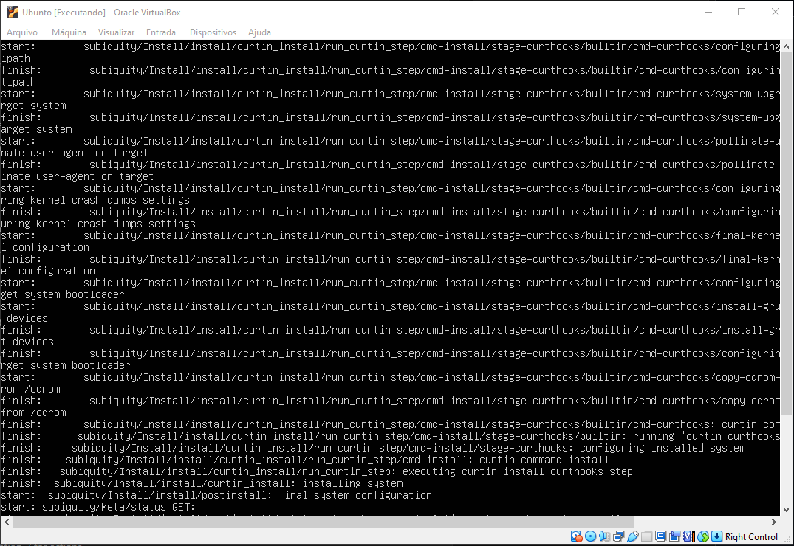
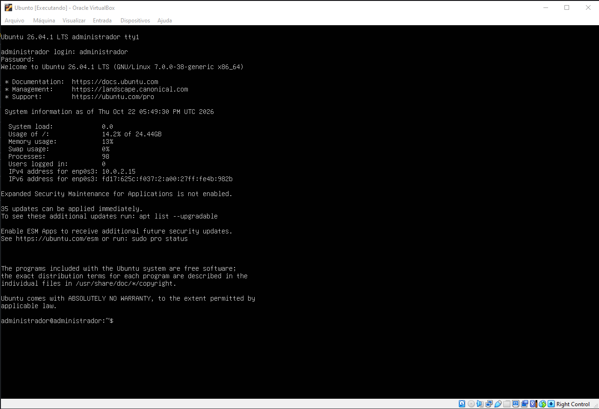

# 🔭 Projeto 01 — Home Lab de Segurança

## 🎯 Objetivo

Montar um laboratório virtual para estudar e praticar Cibersegurança em ambiente seguro e controlado, sem risco para máquinas reais.

---

## 🖥️ Ambiente

| Item | Detalhe |
|------|---------|
| Hypervisor | VMware Workstation Player |
| Sistema Operacional | Ubuntu Linux |
| Host (máquina física) | Windows |

---

## 📸 Configuração do Ambiente

### 1. Instalação do VMware e criação da VM

### 2. Instalação do Ubuntu

### 3. Ambiente pronto

---

## 📚 O que aprendi

- Como criar e configurar máquinas virtuais com VMware
- Primeiros passos com o sistema operacional Linux/Ubuntu
- Conceito de ambiente isolado para testes de segurança

---

## 🚀 Próximos passos

- [ ] Instalar o Kali Linux em uma segunda VM
- [ ] Configurar a rede entre as VMs
- [ ] Realizar primeiros scans com `nmap`
