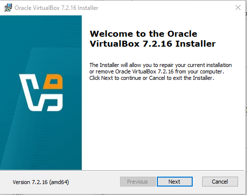
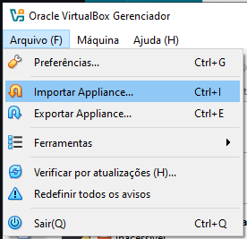
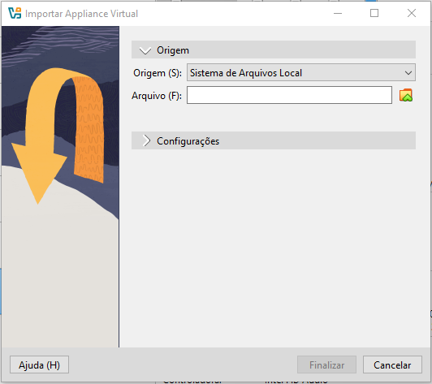
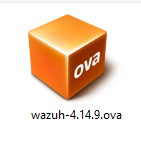
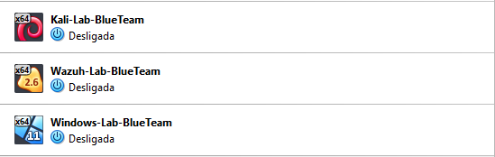
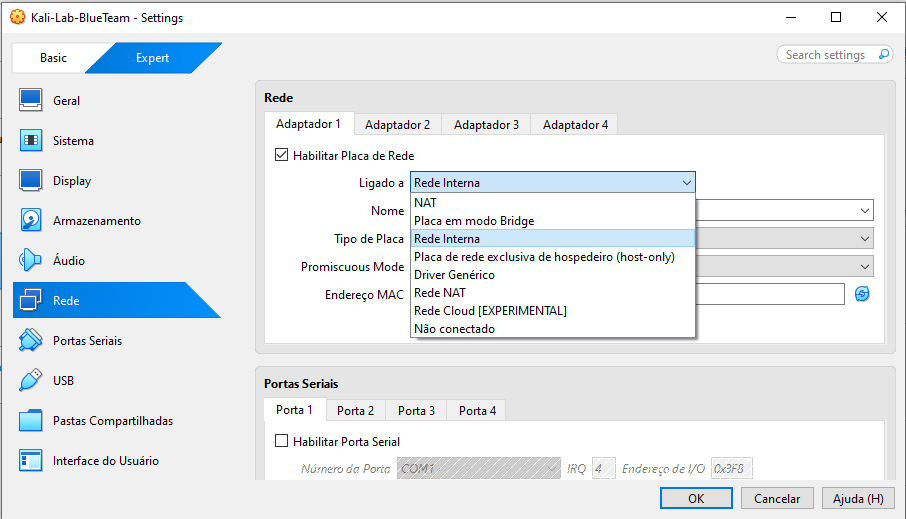
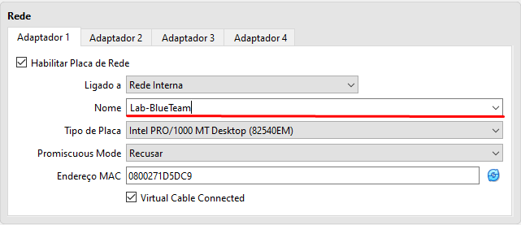

# Home Lab SOC/Blue Team — Fase 1: VirtualBox + Rede Interna + Wazuh (OVA)

Primeira fase da montagem do meu lab de segurança do zero, com foco em SOC/Blue Team. O objetivo final é ter um ambiente isolado com atacante (Kali), alvo (Windows) e SIEM (Wazuh) para praticar detecção de ataques.

Este repositório documenta o passo a passo, os problemas que encontrei e como resolvi — para servir de referência e portfólio.

## Visão geral do lab

| Papel | Ferramenta |
|---|---|
| SIEM | Wazuh (OVA) |
| Alvo | Windows 10/11 |
| Atacante | Kali Linux |
| Rede | VirtualBox Internal Network (`labsoc`) |

## Pré-requisitos

- 16 GB de RAM no host (Wazuh sozinho já usa 8 GB recomendados)
- 100 GB livres em disco
- Virtualização habilitada na BIOS (Intel VT-x ou AMD-V)

## Downloads

| Item | Link |
|---|---|
| VirtualBox | https://www.virtualbox.org/wiki/Downloads |
| VirtualBox Extension Pack (mesma versão do VirtualBox) | https://www.virtualbox.org/wiki/Downloads |
| Wazuh OVA | https://documentation.wazuh.com/current/virtual-machine/virtual-machine.html |
| Windows 11 ISO (avaliação, 90 dias) | https://www.microsoft.com/en-us/evalcenter/evaluate-windows-11-enterprise |
| Kali Linux (VM pronta) | https://www.kali.org/get-kali/#kali-virtual-machines |

> ⚠️ Baixe o Extension Pack na **mesma versão** do VirtualBox instalado (ex.: VirtualBox 7.2.x precisa do Extension Pack 7.2.x), senão a instalação falha.

## Passo a passo

### 1. Instalar o VirtualBox e o Extension Pack

1. Instale o VirtualBox normalmente.
2. Baixe o Extension Pack (`.vbox-extpack`) na mesma versão.
3. **Importante:** baixar não é instalar — dê duplo clique no arquivo `.vbox-extpack` para abrir o instalador dentro do VirtualBox.
4. Confirme em **Arquivo → Preferências → Extensões** que o pacote aparece na lista.

### 2. Importar o OVA do Wazuh

1. Baixe o `wazuh-<versão>.ova` na página oficial.
2. No VirtualBox, vá em **Arquivo → Importar Appliance** (atalho `Ctrl+I`).
3. Navegue até a pasta onde o `.ova` foi salvo e selecione o arquivo.
4. Siga o assistente de importação até finalizar.

<table>
  <tr>
    <td></td>
    <td></td>
    <td></td>
  </tr>
</table>

### 3. Configurar a rede interna isolada

1. Com a VM do Wazuh **desligada**, abra **Configurações → Rede**.
2. No Adaptador 1, mude de **Bridge** para **Rede Interna**.
3. Defina o nome da rede como `labsoc` — esse mesmo nome será usado em todas as VMs do lab (Windows, Kali), para que fiquem isoladas da rede doméstica e se enxerguem entre si.

<table>
  <tr>
    <td></td>
    <td></td>
    <td></td>
  </tr>
</table>

## IPs planejados

| VM | IP |
|---|---|
| Wazuh Manager | 192.168.56.10 |
| Windows alvo | 192.168.56.20 |
| Kali Linux | 192.168.56.30 |

## Problemas encontrados e soluções

### "O arquivo .ova não aparece para importar"

Causa: eu estava tentando importar pela janela errada do VirtualBox — a de **Adicionar Máquina Virtual** (filtro `*.xml, *.vbox`), que serve para abrir VMs já existentes, não appliances.

A tela certa é **Arquivo → Importar Appliance**, acessível também pelo atalho `Ctrl+I`, a partir da janela principal do VirtualBox (Gerenciador).

### "Instalei o Extension Pack, mas parece que não resolveu nada"

Esse é um passo separado do import do OVA — o filtro `*.vbox-extpack` só serve para instalar a extensão em si (**Arquivo → Preferências → Extensões**), e não tem relação direta com o motivo do `.ova` não aparecer.

### Checando a versão do VirtualBox

Para confirmar se a versão instalada é recente o suficiente (recomendado 7.x para suporte completo a appliances OVF 2.0 e Windows 11 com TPM): **Ajuda → Sobre o VirtualBox**.

## Checklist da Fase 1

- [x] VirtualBox instalado
- [x] Extension Pack instalado
- [x] OVA do Wazuh importado
- [x] Rede da VM do Wazuh configurada como Internal Network (`labsoc`)
- [ ] VM Windows 10/11 criada e na mesma rede
- [ ] VM Kali Linux criada e na mesma rede
- [ ] Teste de `ping` entre as VMs

## Próximos passos

- Fase 2: ligar o Wazuh, acessar o dashboard e trocar a senha padrão
- Fase 3: criar a VM Windows 10/11 (alvo) com Sysmon e agente Wazuh
- Fase 4: criar a VM Kali Linux (atacante)
- Fase 5: primeiro exercício — brute force de RDP e detecção no Wazuh
